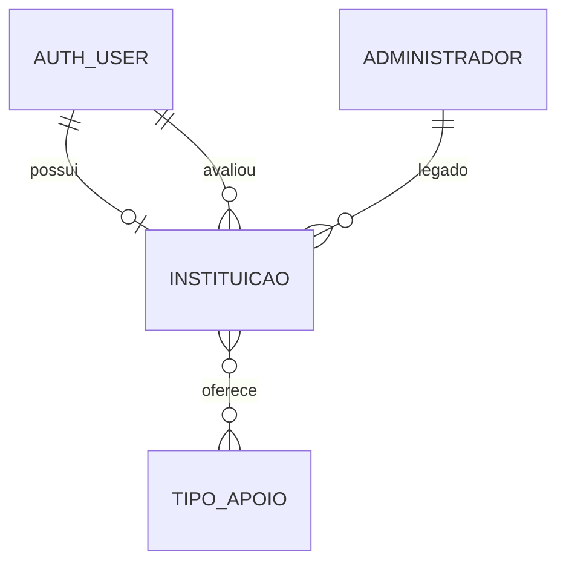

# Banco de dados — ApoioOnco

O único backend configurado é `django.db.backends.mysql`. O schema é controlado pelas migrations; não crie tabelas manualmente nem importe `docs/schema.sql`.

## Preparar MySQL

Instale MySQL 8 ou superior, copie `.env.example` para `.env` e preencha as credenciais locais. Crie banco e usuário com suporte a `utf8mb4`:

```sql
CREATE DATABASE apoioonco CHARACTER SET utf8mb4 COLLATE utf8mb4_unicode_ci;
CREATE USER 'apoioonco'@'localhost' IDENTIFIED BY 'defina-uma-senha-local';
GRANT ALL PRIVILEGES ON apoioonco.* TO 'apoioonco'@'localhost';
```

Configure `MYSQL_DATABASE`, `MYSQL_USER`, `MYSQL_PASSWORD`, `MYSQL_HOST` e `MYSQL_PORT` no `.env`. `MYSQL_SSL_CA` aceita opcionalmente o caminho do certificado CA para conexões remotas que exigem TLS. Nunca versione esse arquivo. Gere um segredo Django próprio com `python -c "from django.core.management.utils import get_random_secret_key; print(get_random_secret_key())"` e configure-o em `DJANGO_SECRET_KEY`. Em produção, configure `DJANGO_DEBUG=False`, `DJANGO_ALLOWED_HOSTS` e um storage S3 compatível (`DJANGO_MEDIA_STORAGE=storages.backends.s3.S3Storage`, `AWS_STORAGE_BUCKET_NAME` e `AWS_S3_REGION_NAME`); o backend local de arquivos é recusado quando `DEBUG=False`.

```powershell
pip install -r requirements.txt
python manage.py migrate
python manage.py createsuperuser
python manage.py runserver
python manage.py test
```

O usuário MySQL usado pelos testes precisa poder criar e remover o banco de teste (`test_apoioonco`). Use credenciais de desenvolvimento/teste, nunca as de produção, ao executar a suíte.

## Migrations e dados legados

As migrations `0004` e `0005` são aditivas. CNPJ e imagem aceitam `NULL` para preservar instituições antigas; o formulário exige ambos os dados novos e atribui `pendente`. Os valores de status existentes `ativo` e `inativo` são convertidos para `ativa` e `inativa`. Nenhuma migration apaga tabelas, registros ou arquivos.

A migration `0003` preserva serviços textuais ao criar as relações N:N em instalações novas. Se ela já foi executada por uma versão anterior que apagou o campo original, editar a migration não a executa novamente; recupere esses valores do backup PostgreSQL se ainda forem necessários.

Antes de trocar uma instalação PostgreSQL existente, faça e guarde um backup físico/lógico e uma exportação de dados **no ambiente anterior**, antes de implantar esta configuração MySQL:

```powershell
pg_dump --format=custom --file=apoioonco-postgres.dump NOME_DO_BANCO
python manage.py dumpdata --natural-foreign --natural-primary --exclude=contenttypes --exclude=auth.permission --output=apoioonco-data.json
```

Arquive também os arquivos referenciados pelos campos de imagem. Depois, crie o schema MySQL com `migrate`, importe a fixture com `python manage.py loaddata apoioonco-data.json` em ambiente de homologação, e confira contagens, relações e login antes de promover. Para fixtures exportadas do schema antigo, normalize os valores de status carregados:

```sql
UPDATE ongs_instituicao
SET status = CASE status WHEN 'ativo' THEN 'ativa' WHEN 'inativo' THEN 'inativa' ELSE status END
WHERE status IN ('ativo', 'inativo');
```

Mantenha o backup PostgreSQL intacto até confirmar a restauração. A aplicação neste workspace não tem credenciais nem conexão com o PostgreSQL de origem, então não foi possível inspecionar ou migrar dados reais.

## Relacionamentos e regras



- `auth_user`: autenticação Django, com senha armazenada por hash; contas administrativas usam `is_staff`.
- `ongs_instituicao`: cadastro, CNPJ único, status, caminho `ImageField`, contatos e vínculo 1:1 opcional a um usuário (nulo para legado).
- `ongs_tipoapoio` e a tabela N:N criada pelo Django: categorias e apoios selecionados.
- `status`: `pendente`, `ativa`, `rejeitada` ou `inativa`; a busca pública consulta somente `ativa`.
- `logo` salva no banco apenas o caminho relativo. O arquivo é escrito pelo storage configurado.
- Visitantes podem pesquisar sem autenticação. Apenas usuários autenticados acessam painéis; a instituição é obtida da sessão, não de um ID enviado pelo cliente.
